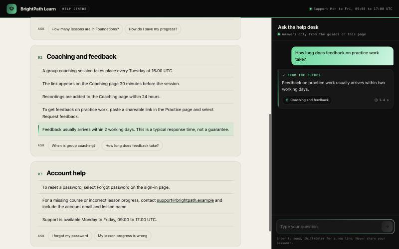

# BrightPath Help Desk

Answers member questions only from the three supplied BrightPath documents, shows the supporting document, says so when the answer isn't there, and gives a clear message when the model is unavailable. Node 22+, no dependencies.



## Run it

```bash
cp .env.example .env                       # add a free key (Google AI Studio), or point at a local model
npm run ask -- "When is group coaching?"   # command line
npm start                                  # web page on http://127.0.0.1:8790
```

Any OpenAI-compatible endpoint works (Gemini, Groq, Ollama). Keys live only in `.env`.

## Test it

```bash
npm test           # 21 offline tests, no key needed
npm run fail-demo  # a real API failure (model URL pointed at a closed port), no key needed
npm run cases      # the three required cases on the real model, saved to results/
```

## How it works

- All three documents go to the model with each question. The model must reply in JSON with its answer, the document ids it used, and exact quotes.
- **Grounding check:** every quote must really appear in a cited document, or the answer is discarded and the member is told it isn't in the documents. A made-up answer can't reach the member.
- **Failures** (no connection, timeout, bad key, rate limit, provider error, unreadable reply) each give a plain message; busy or server errors get one retry.
- **Guards:** a typed password is never sent to the AI; questions and replies are size-capped; repeated questions reuse the earlier answer; the web API allows 10 questions a minute per visitor and listens on this machine only.

**Web page:** a black, off-white and green help centre. The guides on the left are built from the same three documents, and tapping an answer's source highlights the lines it came from. Each answer shows its response time; a slow model shows "slower than usual" after 6 s and a Cancel button after 15 s. Works from small phones to wide screens, in light and dark mode, and all motion switches off when the system asks for reduced motion.

## Fail-safes

| Problem | Student sees | Host sees (terminal, and the page on the host's machine) |
| --- | --- | --- |
| No model set up, no key, wrong key or wrong model | "The help desk is waiting for the host to connect a working AI model", with questions paused and the guides still usable | The exact fix, e.g. "LLM_API_KEY is empty. Add a key to .env..." |
| Model slow, busy, down or unreachable | A plain "try again in a moment" message with a Try again button | What went wrong (timeout, HTTP 429, HTTP 5xx, address) |
| Browser offline | "You're offline", sending paused until it reconnects | |
| Guides fail to load | A Try again button | |
| Port in use, Node too old, docs missing | | A one-line instruction at start-up instead of a crash |

Setup problems are found at start-up or on the first failed call; after that the server stops calling the provider until the host fixes `.env` and restarts. Students never see setup details or error codes.

Main code: `src/helpdesk.js` (prompt, grounding check) and `src/llm.js` (model call, errors). Tested with `gemini-3.5-flash-lite`. Walkthrough and improvements: [WALKTHROUGH.md](WALKTHROUGH.md).
